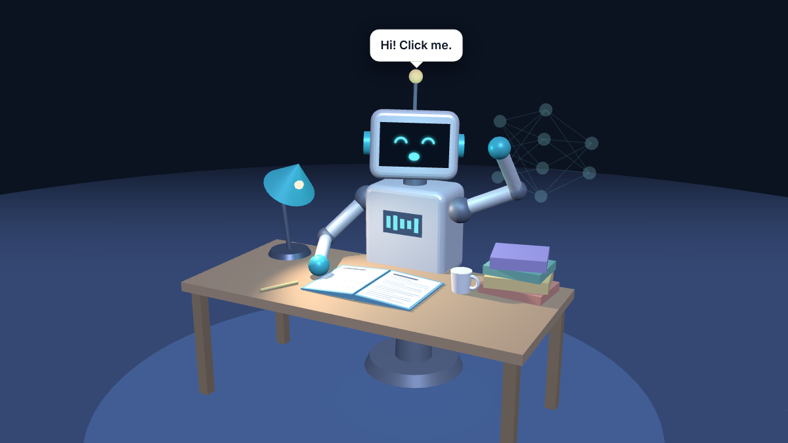

# Welcome Robot



A 3D robot that greets students before the first class and tells them what to do, one step at a time.

The robot sits at a desk and studies. Click it and it looks up, waves, and gives the next step in a speech bubble. Five clicks cover five steps. The sixth click sets off confetti.

Built with [three.js](https://threejs.org/). Everything is in one file, `index.html`.

## See it

Open the GitHub Pages address for this repository:

```
https://cynthialmcginnis.github.io/welcome-arin320/
```

To turn Pages on: **Settings > Pages > Deploy from a branch > main > / (root) > Save**. The address appears on that same screen after a minute or two.

## What students do

1. Open the link.
2. Click the robot. It says step 1.
3. Keep clicking. Each click gives the next step, and the matching label at the bottom of the screen lights up.
4. Drag anywhere to turn the camera.

The page works on a laptop or a phone. It also works with a keyboard: press Tab to select the scene, then Enter or Space.

## What the robot does on its own

Between clicks, the robot runs through a routine:

- Reads, and turns the page with its hand.
- Dozes off. Its eyes close and its head sinks.
- Jolts awake and shakes its head.
- Picks up the coffee mug and drinks.
- Has an idea. Its arms go up, its antenna flashes, and the neural network beside it lights up layer by layer.

## Sound

The page plays soft study music and a sound for each thing the robot does: a page turn, a jolt awake, a sip of coffee, a chime for an idea, and a fanfare at the end. The robot beeps when it talks.

- Sound starts at the student's first click. Browsers do not allow a page to play sound before that.
- The **Sound: on / Sound: off** button in the top right corner turns it off. The page remembers the choice.
- The music is generated by the page. There are no audio files and nothing to license.

To change the defaults, edit `SOUND_ON` and `MUSIC_VOLUME` in the text block described below.

## Change the text

All the words students read are in one block near the top of the script in `index.html`. Look for this comment:

```
// TEXT YOU CAN CHANGE. Everything the students read is in this block.
```

| Setting | What it controls |
| --- | --- |
| `FIRST_CLASS` | The date line at the bottom of the screen and on the still image |
| `GREETING` | What the robot says when the page first opens |
| `STEPS` | The steps. `chip` is the short label on screen. `say` is what the robot says. Add or remove lines to change the number of steps. |
| `FINISH` | What the robot says after the last step |
| `WORDS` | The words that float up when the robot has an idea |
| `IMAGE_BUBBLE` | The speech bubble text on the still image |
| `IMAGE_BUTTON` | The button text on the still image |
| `SOUND_ON` | `true` plays sound unless the student turns it off. `false` stays silent unless the student turns it on. |
| `MUSIC_VOLUME` | How loud the music is, from 0 (silent) to 1 (loud) |

Keep the quotation marks and commas as they are. Change only the words inside the quotation marks.

To change what the robot does between clicks, edit the `ROUTINE` list further down. Each entry is an action and the number of seconds it lasts.

Do not edit anything below the line that says `Do not edit below this line`. That section is the three.js library.

## Use it in an email

Email cannot run 3D. Put a picture in the email and link the picture to this page.

1. Add `#instructor` to the end of the page address and open it.
2. Click **Save image for email**. The robot waves and the page downloads a PNG.
3. Insert the PNG into the email.
4. Link the picture to the page address, without `#instructor`.
5. Add the same address as a plain text link under the picture. Some mail programs hide pictures until the reader allows them.

Students never see the Save button. It appears only when the address ends in `#instructor`.

## Requirements

- A current browser: Chrome, Edge, Firefox, or Safari.
- No installation and no account.
- No outside files. The three.js library is included inside `index.html`, so the page loads nothing else.

## Known limits

- The page does not run inside an email or as an email attachment preview. Send the link.
- Very old phones and computers without 3D graphics support show the text but not the robot.
- The page does not record clicks. It cannot tell you which students opened it.

## Credits

Designed and built by Cynthia McGinnis.

This page includes three.js r128, copyright three.js authors, used under the MIT License.
